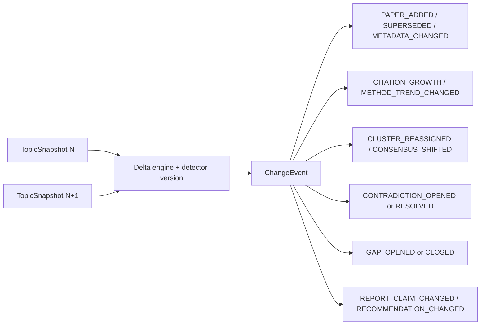
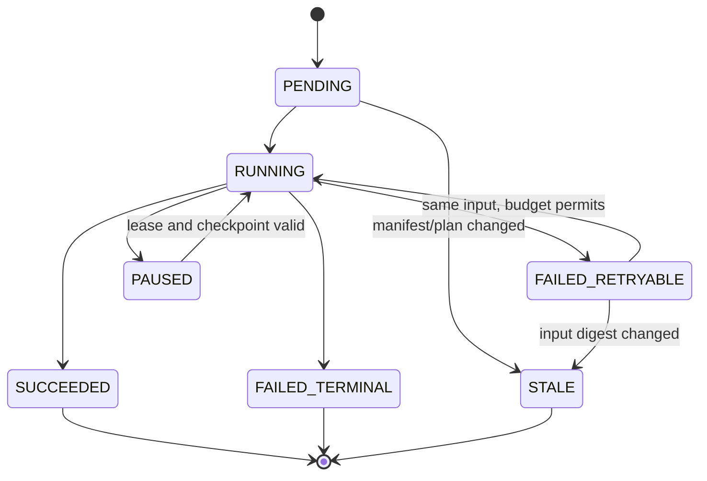

# Target desktop architecture, Research Memory and large-corpus synthesis

Authority capsule: adopted M1 implementation authority `3c4dd21b4505d94463cd15fb38857c54812719e3`, tree `0df0675d486cd1e6a5c75edbccb280662731c11a`; desktop-host foundation `8e967ae96553c7fdee9f24b9d90ca49bc2cf481c`; historical pre-M1 v2 authority `635380c7280d704bcc4c9ccf15e24b412323e8d9`; recovery checkpoint `6c2c9cb4aca242bd1d7e7480bd8f221946b8d114`; preserved Provider authority `d060383a441308f842e1e853c5bb2d1912e79a3a`; canonical `131d909cfcfe0af9140664277f484783cbac52bb`. Owner adopted the M1 target implementation by fast-forward only. `INITIAL_PROTOTYPE_FEATURE_GOALS_COMPLETE_LOCAL_SCOPE` remains preserved. Tauri desktop foundation is implemented and locally qualified; Long-term Memory and Large-Corpus Synthesis are not implemented; production/staging/external beta remain no-go.

## Decision summary

Adopted M1 implementation: **Tauri host + current React/Vite frontend + packaged FastAPI sidecar + current SQLite/filesystem repositories behind facades**. The feasibility spike passed, so Electron was not used. A native-widget rewrite remains rejected because it discards the strongest reusable assets without evidence that React/Vite or FastAPI is the constraint.

Status: `IMPLEMENTED_AND_LOCALLY_QUALIFIED_IN_M1`. This implementation claim is bounded to the native host, sidecar, semantic appearance, compatibility routing and truthful resource-state foundation. No Research Memory migration or Large-Corpus Synthesis implementation has occurred.

## M1 packaging reality

The repository now tracks a Tauri host, PyInstaller-packaged FastAPI sidecar contract, single-instance/window-state lifecycle, native file-dialog bridge and local NSIS packaging configuration. The host synchronizes native chrome with the resolved semantic theme, while browser-compatible `/app` mode remains available for development. It does not track or claim an Electron, Wails, Neutralino, PySide/Qt, WPF/WinUI host. Updater, tray, signing and release publication remain excluded.

Reusable lifecycle evidence:

- `app/main.py` serves `web/dist` under `/app` and owns FastAPI startup/shutdown/router lifecycle.
- `web/src/lib/api.ts` uses same-origin outside Vite development and `credentials: include`.
- `tools/prototype_launcher.py` already owns process groups, loopback ports, readiness polling, graceful shutdown and listener cleanup.
- `scripts/start-local.ps1`, `start-prod.ps1`, `start-prototype.ps1`, `/health/ready` and `XRML_DATA_DIR` provide reusable behavior contracts.
- The adopted host reuses those contracts and serves the built React/Vite SPA from the packaged sidecar with same-origin API/session behavior.

Local M1 artifact identities:

| Artifact | Bytes | SHA-256 | Status |
| --- | ---: | --- | --- |
| `xrml-desktop-host.exe` | 11,823,104 | `84286308c504560f663df38a9339c250d8026a956271d8f92872bc1febf991b6` | local native host evidence |
| `xrml-sidecar.exe` | 33,816,788 | `5563e4f17762efa1875caca6aee29e7979cffd0b10c74a56bdb685dfec5ecf7b` | packaged FastAPI sidecar evidence |
| `XRML Research Agent_0.1.0_x64-setup.exe` | 36,028,574 | `05d2f146c66b81d58e7fb7a97833ffc04c2085c5aa2208489a988580a04f8f8d` | unsigned local installer candidate; not a release |

The D-drive-only requalification ran one semantic native smoke across three product starts with zero retry and task-owned C-drive delta `0`.

## Weighted desktop-host scoring

Scores are 0–10 per criterion, multiplied by the owner-specified weights and normalized to 100.

| Criterion | Weight | Tauri | Electron | Native-widget rewrite |
| --- | ---: | ---: | ---: | ---: |
| Existing frontend reuse | 25 | 10 | 10 | 1 |
| Existing backend reuse | 15 | 9 | 9 | 8 |
| Existing test reuse | 10 | 8 | 9 | 3 |
| FastAPI sidecar lifecycle fit | 10 | 8 | 9 | 7 |
| Windows installer/distribution | 10 | 9 | 8 | 8 |
| Theme/native-window integration | 10 | 9 | 8 | 10 |
| Security/sandbox boundary | 8 | 9 | 6 | 8 |
| Runtime footprint/performance | 5 | 9 | 4 | 8 |
| Accessibility | 4 | 8 | 9 | 7 |
| Maintenance complexity | 3 | 7 | 6 | 3 |
| **Weighted score** | **100** | **89.5** | **84.7** | **56.6** |

### Tauri

- Retains React/Vite, FastAPI, SQLite, `XRML_DATA_DIR`, API/session behavior and most tests.
- Result: Rust/native toolchain, packaged sidecar, same-origin/session, shutdown/storage guards and webview behavior passed the bounded M1 spike and requalification.
- Disqualifier status: none triggered; signing remains a separate release-hardening gate.

### Electron

- Retains almost all frontend/backend/tests and offers mature process/window APIs.
- Risks: larger runtime, higher memory footprint and a weaker default security boundary.
- Role: only fallback, evaluated with the same acceptance contract if Tauri fails.

### Native-widget rewrite

- Retains backend and storage only.
- Discards current view composition, React test assets and browser API behavior.
- Role: no fallback. Reconsider only if both webview hosts fail for a demonstrated technical reason.

## Recommended process and sidecar lifecycle

```mermaid
flowchart LR
    U[Windows user] --> H[Tauri host]
    H --> G[Single-instance and window-state guard]
    H --> P[Reserve ephemeral 127.0.0.1 port]
    H --> F[FastAPI packaged sidecar]
    H --> V[WebView loads /app]
    F --> R[/health/ready]
    V --> F
    F --> S[(XRML_DATA_DIR: SQLite + artifacts)]
    F --> C[Provider/report/evidence contracts]
    H --> D[Native open/save dialogs]
    H --> Q[Graceful shutdown and orphan/listener check]
```

Lifecycle contract:

1. Host obtains single-instance lock and restores validated window geometry.
2. Host creates/resolves an application data root; it never embeds runtime DB/content in the installer.
3. Host reserves a loopback-only ephemeral port and passes `XRML_DATA_DIR`, `APP_BASE_URL` and `WEB_APP_BASE_PATH=/app`.
4. Host starts exactly one packaged FastAPI child in a process group.
5. Host waits with a bounded deadline for `/health/ready`; webview navigation is gated on success.
6. Webview loads the sidecar-served built SPA, preserving same-origin cookies and API URLs.
7. Native dialogs return paths through a narrow command bridge; the backend retains path-safety validation.
8. On close/crash, host requests graceful shutdown, then bounded termination; it proves no orphan process, listener, WAL/SHM or partial transaction.
9. Provider OAuth/session remains an external Provider boundary. Desktop host must not read or copy Provider credential caches.

Updater, tray, native menu and code signing remain gated after the M1 spike. A local unsigned installer artifact can prove packaging mechanics; it is not a release.

## M1 feasibility spike result

The bounded spike built a clean sidecar executable plus `web/dist`, launched it on loopback, gated on readiness, opened the active topic workspace, exercised existing read/safe settings paths, covered bounded shutdown/crash recovery, single-instance/window state and native dialog contracts, synchronized semantic appearance, and produced one local unsigned Windows installer candidate.

Fallback decision:

- All required M1 criteria passed; keep Tauri.
- If a listed disqualifier occurs, run the identical spike with Electron once.
- Do not fall back to native widgets and do not alter backend contracts merely to make the host look green.

## Theme-system audit and contract

The historical M0 `web/src/v2/v2.css` declared `color-scheme: dark`, about 20 `--v2-*` variables and 139 hex literals. M1 replaced that authority with semantic tokens, a typed appearance store/provider, OS-following System mode, visible focus, contrast coverage and reduced-motion behavior. Checkpoint `tokens.css` remained a naming donor rather than restored visual authority.

The DOM/component migration remained incremental while the color authority was replaced in M1.

### Semantic tokens

- Surfaces: `surface.app`, `surface.sidebar`, `surface.panel`, `surface.elevated`, `surface.hover`.
- Text: `text.primary`, `secondary`, `muted`, `inverse`.
- Borders: `border.default`, `border.strong`.
- Accent: `accent.base`, `hover`, `active`, `subtle`, `onAccent`.
- Navigation: `nav.background`, `nav.text`, `nav.activeBackground`, `nav.indicator`.
- Status: success, warning, danger, info, unavailable.
- Focus: `focus.ring`, `focus.offset`.
- Charts: `chart.series.1..8`, grid, axis, tooltip.
- Graph: topic node, cluster nodes, selected node, edge, muted edge.

Implemented themes: System, Light, Dark, Solarized Light and Solarized Dark. The semantic contract supports bounded accent handling without turning appearance into research-data authority.

Rules:

1. Explicit theme overrides OS; System tracks OS changes.
2. `WorkspaceAppearancePreferences` is authoritative under XRML storage/API. localStorage may cache last-known values only.
3. Window chrome receives the resolved theme/accent; research data never depends on appearance.
4. Active navigation uses shape/indicator/weight, not color alone.
5. All themes meet text/control/focus contrast; forced-colors/high-contrast has a fallback.
6. Chart series are color-vision-safe and also use labels/shape/line style.
7. Reduced-motion disables nonessential transitions and graph/chart animation.
8. Density, time format and window state persist separately and safely.

Required tests: token completeness, contrast matrix, keyboard/focus, forced-colors, reduced-motion, system-theme event, explicit override, persistence/restart, chart legend/accessible table and screen-level visual regression for five views × required themes at representative viewports.

## Current persistence truth

| Area | Current authority | Keep/change |
| --- | --- | --- |
| Runs | per-run `run.json`, append-only `events.jsonl`, artifacts | Keep behind RunRepository; add typed indexing, never rewrite history wholesale. |
| Metadata/reviews | SQLite `runs`, `run_topics`, `papers`, `evidence`, `report_sections`, `paper_reviews`, `ai_review_drafts`, `index_state` | Declare authority vs projection ownership; extend with migrations. |
| Prototype workspace | lock-held whole `workspace.json` | Keep behind facade, dual-read/backfill; retire whole-document mutation after digest parity. |
| Topic profiles | separate profile JSON | Reconcile with canonical Topic identity through facade. |
| Full text | immutable filesystem artifacts with digests | Keep artifacts; index versions/rights/locators. |
| Reports | immutable accepted versions + mutable manifest + transaction journal | Preserve final acceptance and recovery boundary. |
| Provider execution | request/quarantine/candidate/outcome records | Preserve; candidate not authority until accepted. |
| Jobs/schedules | SQLite leases, heartbeats, queue/idempotency | Reuse fencing; add stage/shard checkpoints. |
| Notifications | capped JSON history | Operational only; not long-term memory. |
| Bundle | portable bounded projection | Keep; never call it backup/runtime authority. |

Do not introduce a duplicate database. Extend existing SQLite repositories, retain immutable filesystem artifacts and use dual-read facades during migration.

## Long-term Research Memory

### Entity disposition

| Layer | Entity | Existing equivalent/precursor | Target identity and lifecycle | Disposition | Milestone |
| --- | --- | --- | --- | --- | --- |
| Bibliographic | Paper | run-scoped paper rows | canonical DOI/PMCID/arXiv/provider ID; digest fallback | extend | M2 |
| Bibliographic | PaperVersion | source/content digests only | immutable `paper_id + metadata/fulltext digest`, supersedes link | new | M2 |
| Bibliographic | Author | embedded strings | normalized identity + aliases; versioned assertions | new | M2 |
| Bibliographic | Institution | embedded strings | normalized identity + source assertions | new | M2 |
| Bibliographic | Venue | embedded strings | normalized venue/source assertion | new | M2 |
| Bibliographic | Dataset | free text/tags | controlled term + evidence membership | new | M3 |
| Bibliographic | Method | free text/tags | controlled term + evidence membership | new | M3 |
| Bibliographic | PaperTopicMembership | implicit run/snapshot inclusion | versioned junction to TopicSnapshot | extend | M2 |
| Evidence | Claim | typed artifacts/provider models | indexed claim, schema version, acceptance state | new | M3 |
| Evidence | EvidenceSpan | embedded review JSON + projection | paper-version ID, locator, text hash, stale/superseded | extend | M2 |
| Evidence | Result | review field | typed observation + evidence links | extend | M3 |
| Evidence | Limitation | review field | typed observation + evidence links | extend | M3 |
| Evidence | Contradiction | `conflicting_findings` gap precursor | evidence-backed open/resolved lifecycle | new | M3 |
| Evidence | Recommendation | Prototype records | versioned recommendation + decisions | extend | M3 |
| Evidence | ReportSection | artifact/count precursor | versioned section/claim/evidence links | extend | M4 |
| Temporal | TopicSnapshot | Prototype deterministic snapshots | immutable snapshot digest and item set | extend | M3 |
| Temporal | ChangeEvent | curation/living/comparison records | append-only typed event envelope | extend | M3 |
| Temporal | TrendMetricSeries | latest overwritten analytics | append-only metric/version/window points | extend | M3 |
| Temporal | ClusterAssignment | none | snapshot-bound assignment + method/version | new | M3 |
| Temporal | ConsensusState | none | snapshot-bound claim consensus | new | M3 |
| Temporal | ContradictionState | none | snapshot-bound contradiction lifecycle | new | M3 |
| Decision | InsightRecord | analytics/gap/briefing fragments | immutable provenance-bound derived record | new | M3 |
| Decision | InsightAcceptance | fragmented recommendation/provider decisions | unified accept/reject/hold state machine | extend | M3 |
| Decision | ResearchGap | Prototype gap records | snapshot/evidence-bound versioned gap | extend | M3 |
| Decision | RecommendedAction | recommendation fragments | action contract + preconditions/outcome | extend | M3 |
| Decision | UserDecision | immutable decision records | actor/action/reason/time with fencing | extend | M3 |
| Report | CorpusManifest | topic snapshot/evidence-set digests | frozen ordered paper-version/evidence tuples | extend | M4 |
| Report | ReportPlan | report request precursor | typed sections/objective/provider policy | extend | M4 |
| Report | ReportCandidate | Provider/deterministic candidate | quarantined schema/evidence-validation state | extend | M4 |
| Report | ReportVersion | immutable accepted versions | exact candidate/parent/corpus/provenance | extend | M4 |
| Report | SynthesisJob | monolithic run_job precursor | staged leased job with manifest key | new | M4 |
| Report | SynthesisShard | none | immutable input digest + stage result/checkpoint | new | M4 |

Quantitative coverage: 32 target entities; 18 current equivalents/precursors extended; 14 new; zero wholesale replacements; 27 persistent schema/backfill changes and five facade/index-first adaptations.

### SQLite extension

Target typed tables:

- `canonical_papers`, `paper_versions`, `paper_occurrences`, `paper_topic_memberships`
- `evidence_spans`, `claims`, `claim_evidence_edges`
- `topic_snapshots`, `topic_snapshot_items`, `change_events`
- `corpus_manifests`, `corpus_manifest_items`
- `cluster_assignments`, `consensus_states`, `contradictions`
- `synthesis_jobs`, `synthesis_shards`, `synthesis_artifacts`

Indexes prioritize canonical identifiers, snapshot/time, topic membership, evidence locator/hash, claim/evidence joins, job state/lease and manifest/shard digests. Retention keeps immutable accepted versions and decision/events; projections can rebuild; raw Provider streams follow existing bounded/redacted policy.

### Delta model



Every event carries previous/current snapshot IDs, affected entity/version IDs, evidence IDs, detector/version digest and timestamp. Every insight additionally carries topic, run, Provider execution and acceptance state. Two real snapshots must reproduce the same events byte-for-byte.

## Large-corpus synthesis contract

One long prompt is prohibited. The reusable final boundary is:

`Reviewed Paper Records → CorpusManifest → Shard/Cluster Plan → SynthesisShard → ClusterSummary → Evidence and Contradiction Matrix → Section Synthesis → Cross-Section Consistency → ReportCandidate → Schema Validation → Evidence Validation → Acceptance → ReportVersion`.

### Stage contract

| Stage | Reusable current service | New/extended entity | Input → output | Idempotency key / resume | Failure and retry | Provider/validation/acceptance/persistence | UI state |
| --- | --- | --- | --- | --- | --- | --- | --- |
| Freeze corpus | Prototype snapshots, review/evidence services | `CorpusManifest` | accepted TopicSnapshot + selection → ordered paper/evidence set | digest of ordered paper-version/evidence/selection tuples; immutable reuse | selection drift = stale/terminal until refreeze; no automatic semantic retry | no Provider; validate IDs/digests; persist manifest | “Corpus frozen”, counts, digest, excluded reasons |
| Plan shards | topic analytics, deterministic grouping precursor | `SynthesisJob`, plan artifact | manifest + ReportPlan → clusters/shards | `manifest_digest + plan_digest + pipeline_version`; recompute deterministically | unsupported size/config terminal; planning code fix then explicit restart | deterministic preferred; schema validate plan; persist before leases | planned shards, estimated coverage |
| Synthesize shard | Provider router, run-job leases | `SynthesisShard` | bounded paper/evidence packet → typed shard summary | `job_id + cluster_key + ordered_input_digest + stage_version`; resume missing/retryable | transport/timeouts retryable under configured budget; schema/evidence terminal | Provider allowed; quarantine; validate allowed IDs; no report acceptance | queued/running/succeeded/retryable/terminal |
| Cluster summary | deterministic reporting + Provider validation | synthesis artifact | accepted shard outputs → cluster summary | ordered accepted shard-output digests | input change marks stale; recompute cluster only | optional Provider; schema/evidence validation; artifact only | cluster coverage and warnings |
| Evidence/contradiction matrix | evidence validation/gap precursor | claims/contradictions artifact | cluster summaries + spans → claim/evidence/conflict matrix | sorted claim/evidence digests + detector version | missing coverage terminal for required claim; deterministic recompute | deterministic first; no acceptance; persist indexed links | coverage %, unsupported risk, contradiction count |
| Section synthesis | report request assembly | `ReportSection` candidate | matrix + ReportPlan section → typed section | job/section + ordered source artifact digests | shard/section retry only when input stable; schema/evidence failures terminal | Provider stage bounded to section; validate references; candidate only | section progress and source count |
| Cross-section consistency | report quality/validation | consistency artifact | sections → conflicts, duplicates, unsupported claims | ordered section digests + validator version | findings require repair/recompute; no silent acceptance | deterministic validators; optional bounded repair stage; persist findings | blocking/nonblocking findings |
| Build candidate | provider report integration | `ReportCandidate` | validated sections + matrix → canonical candidate | schema + section + matrix digests | malformed candidate terminal | no direct authority; quarantine and persist candidate | validated-pending-acceptance |
| Schema validation | canonical Pydantic/output schema | candidate validation record | candidate → schema outcome | candidate digest + schema version | terminal until repaired/new candidate | current strict schema; no retry that weakens schema | exact path/message, safe |
| Evidence validation | current evidence-reference validation | validation record | candidate + manifest allowed IDs → evidence outcome | candidate/manifest/validator digests | unknown/missing reference terminal | current fail-closed policy | coverage and offending safe IDs |
| Acceptance | current provider output acceptance | `UserDecision`/acceptance outcome | validated candidate + actor decision → accepted/rejected | execution/candidate + actor/action fencing | duplicate is idempotent; invalid transition rejected | existing explicit acceptance; no Provider | accepted/rejected with actor/time |
| Persist ReportVersion | report transaction/recovery | `ReportVersion` | accepted candidate → one immutable version | accepted candidate + parent version + transaction ID | transaction recovery; no duplicate version | existing transaction, lineage and export paths | new version, parent, corpus, provenance |

State machine:

`PENDING → RUNNING → SUCCEEDED | FAILED_RETRYABLE | FAILED_TERMINAL | PAUSED | STALE`.

Persist each stage checkpoint before releasing the lease. Resume only missing or retryable shards with unchanged input digest. Schema/evidence failures are terminal until explicit repair; changing wording or weakening validation is not a retry. Deterministic fallback may run per shard/section, must be labelled and must pass the same final validation and acceptance.



### Required operational behavior

- Exact corpus and evidence packet are frozen and displayable.
- Pause/resume and process restart preserve stage state.
- One failed shard can recompute without repeating accepted shards.
- Incremental update reuses unchanged prior shard/section digests.
- Coverage is measured at corpus, paper, claim, evidence and section levels.
- Unsupported-claim and contradiction findings block acceptance according to policy.
- Report version diff ties changes to corpus, evidence, Provider and decision deltas.
- Candidate/validation/acceptance/persistence remain separate.

## Security and testing

Security boundaries:

- Sidecar binds loopback only and validates Host/origin/session.
- Native bridge allowlists commands and paths; file paths still pass backend path-safety checks.
- Host never reads Provider credential files/tokens/cookies.
- Runtime state lives under resolved `XRML_DATA_DIR`, outside installer and source.
- Provider packets contain only manifest-approved records/evidence.
- Raw streams stay quarantined/redacted; accepted records contain safe IDs/hashes.
- Migrations are backed up, fingerprinted, transactional and recoverable.

Characterization and acceptance suites:

1. Existing backend run/review/evidence/report/Provider/job/scheduler/bundle suites remain green.
2. Dual-read repository digests compare old/new stores before cutover.
3. Two-snapshot delta golden cases cover every ChangeEvent type.
4. Job tests cover lease loss, pause, restart, stale input, shard retry and exact-once final version.
5. Provider stages inject wrong schema, unknown evidence, unsupported claims and secret-shaped values.
6. Desktop tests cover readiness timeout, child crash, graceful exit, orphan/listener/SQLite cleanup, single instance, file dialogs and restart state.
7. Accessibility/theme tests cover keyboard, focus, contrast, forced colors, reduced motion and visual regression.

## Graph-backend disposition

Do **not** introduce a graph database by default. Typed SQLite junction tables and indexes cover claim/evidence, paper/topic, cluster and report lineage at the current scale and preserve existing backup/migration skills. Re-evaluate only after measured query plans on a real large corpus demonstrate that indexed SQLite cannot meet an owner-approved latency/volume requirement.

Repair evidence remains anchored at `fa29a0f24827006bf647ff1bb042a8d2cf0e0844`; this read-only audit does not move that ref.
