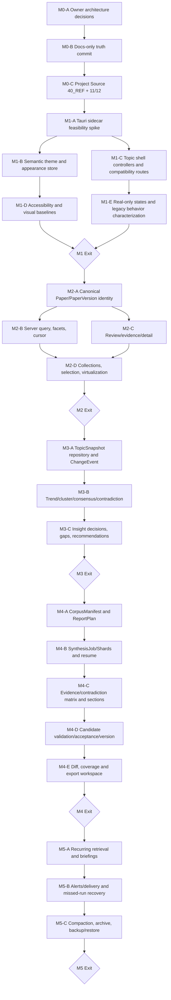

# M0–M5 Native Research Workspace roadmap

## Integrated execution — 2026-10-28

The current Owner instruction extends local implementation beyond the historical
milestone scopes below. Starting authority: clean main `3db71003`. The matching
2026-10-26 Project Source was read; completed Paper Bank, snapshot, review, PDF,
document-plan and Journal flows remain the foundation. Current results belong in
[public checkpoint and readiness](../OPEN_SOURCE_READINESS.md), not the frozen STATUS ledger.

1. Browser collection first: the observed Windows default is Whale. Implement one
   extension + Native Messaging path, initially bounded to versioned arXiv papers.
   Search uses the official metadata API; browser Downloads API owns download IDs
   and completion. The app verifies actual PDF bytes and preserves query, source,
   version, attempts and interruption/authentication states. A user confirms the
   paper/file association before existing Paper Bank/PDF analysis paths receive it.
   Collection never authorizes external AI transmission. Actual Whale and logged-in
   publisher acceptance remain separate from synthetic fixture evidence.
2. In parallel, add minimal startup phase observations around loader/import/app
   initialization. Preserve the failed installed 35-second observation and separate
   later 6.641-second pass. No SQLite redesign or timeout increase without cause.
3. Prepare an inspectable public source candidate using existing packaging policy.
   Inspect its full current tree and reachable history/metadata; keep private source
   evidence outside the candidate. The Owner identified CAPTW/ResearchAgent; the
   public destination was empty on initial inspection. The Owner subsequently
   approved the reviewed separate public history and identity; first and follow-up
   non-force pushes are recorded in current readiness. Continue reviewed file-only
   synchronization through the separate public checkout. The canonical fetch remote
   retains a disabled push URL to prevent exposing private development parents.
4. After collection recovery is usable, extend common analysis fields and readable
   briefs/comparisons, Dashboard continuity, per-run AI selection and bounded local
   model tasks. Preserve explicit/modeled/missing/inapplicable/incomplete distinctions.
5. Optional 3D and small isolated CPU reproduction experiments follow real product
   dependencies, with 2D/table alternatives and separate execution/scientific claims.

Each implementation receives affected checks, an independent review, repairs,
an evidence update and a logical local commit. No live paid calls, new account use,
scheduled collection, user DB restore, publication or release is implied by local
implementation. Reuse the existing status and readiness documents for resumability.

Immediate continuation: qualify the backend suite on the reviewed public tree
with enough job time to finish. The cross-platform mypy discrepancy is resolved
at the same 559-error debt baseline; this is not a clean typecheck. Optional PDF
import and synthetic public test-input corrections have been implemented. Browser
collection remains the first research-function objective: local persistence,
synthetic recovery and analysis handoff exist, but actual Whale native invocation
still fails before download. New error guidance explains the distinct failures;
it is not acquisition acceptance. Next real verification depends on diagnosing
that host lookup through an allowed path, preserving the approved one-paper scope.
Common brief and next-plan model controls can continue independently. The first
Ollama protocol adapter has synthetic-only verification; Settings selection and a
versioned local document-plan path now extend the existing input preparation. Actual
local inference, model/capacity/quality qualification, period-review denominator
semantics, optional 3D and isolated experiments remain later work.

Status update: see [current public checkpoint](../OPEN_SOURCE_READINESS.md). The milestone contracts below remain useful; the historical M1-era implementation status in this document is superseded by M2, M3-A, M3-B and the local main adoption.

Adopted M1 implementation authority is `3c4dd21b4505d94463cd15fb38857c54812719e3`, tree `0df0675d486cd1e6a5c75edbccb280662731c11a`; desktop-host foundation is `8e967ae96553c7fdee9f24b9d90ca49bc2cf481c`; M0 predecessor is `634a5967ae63697343ce89ff23f7ea070326f72f`; historical pre-M1 v2 authority is `635380c7280d704bcc4c9ccf15e24b412323e8d9`; recovery checkpoint is `6c2c9cb4aca242bd1d7e7480bd8f221946b8d114`; Provider live acceptance remains attributed to `d060383a441308f842e1e853c5bb2d1912e79a3a`; canonical is `131d909cfcfe0af9140664277f484783cbac52bb`. `INITIAL_PROTOTYPE_FEATURE_GOALS_COMPLETE_LOCAL_SCOPE` remains preserved. M0 and the local-Windows M1 foundation are complete; M2, M3, M4 and M5 have not started. Production/staging/external beta remain no-go.

## Governing rules

1. Preserve React/Vite, FastAPI, SQLite, `XRML_DATA_DIR`, current run/report/evidence/Provider identities and explicit candidate acceptance.
2. Use checkpoint `6c2c9cb4` only as a read-only behavior/test donor. Do not restore giant legacy JSX/CSS wholesale.
3. Each active control is real, explicitly disabled, or absent.
4. Add typed repositories behind facades; dual-read and digest-compare before any authority cutover.
5. No single-prompt large-corpus architecture, no default graph database and no production/staging/external-beta claim.
6. Each milestone refreshes repository truth and Project Sources only after its committed acceptance evidence exists.

## Ticket graph

## M0 — Current-v2 Architecture Rebaseline and Migration Contract — COMPLETE

Historical purpose: turn the read-only audit into owner-approved repository truth without implementing product code. M0 completed at `634a5967ae63697343ce89ff23f7ea070326f72f`.

| Dimension | Contract |
| --- | --- |
| Reused assets | The six audit Markdown documents and JSON; current identities; Provider acceptance attribution; `6c2c9cb4` donor relation. |
| New contracts | Current-v2 authority model, route/legacy disposition, 105-element UI mapping, desktop decision, semantic theme, 32-entity memory model, staged synthesis design. |
| Excluded | Product code, tests/build/install, desktop spike, runtime migration, Provider/live calls, package generation during this audit. |
| Dependencies | Owner decisions 1–10; exact docs-only file scope. |
| Risks | Treating `design-qa.md` as parity evidence; losing d060 acceptance attribution; hiding current v2 defects behind design language. |
| Characterization | Cross-document identity/count/token scan; current clean HEAD/tree; docs link/path policy. |
| Acceptance | Every core capability and all 105 elements classified; mock/legacy parity gaps explicit; owner signs architecture and M1 scope. |
| Rollback/compatibility | Docs-only commit can be reverted without touching implementation; `STATUS.md` remains historical/frozen. |
| Project Source timing | After the docs-only commit and its validation, create one D-drive package with 40_REF and 11/12. |

M0 Exit Gate:

- `635380c7` accepted or rejected explicitly as architecture baseline.
- Tauri/Electron fallback, five-tab workspace, semantic themes, memory, synthesis and legacy retirements decided.
- Repository architecture docs committed and self-consistent.
- Exact M1 scope approved.

## M1 — Native Research Workspace Foundation — COMPLETE (LOCAL WINDOWS)

Completed scope:

1. `M1-A` Tauri host/sidecar feasibility spike with Electron fallback criteria.
2. `M1-B` semantic tokens, `WorkspaceAppearancePreferences`, System/Light/Dark/Solarized, accents and desktop chrome sync.
3. `M1-C` split `V2TopicWorkspaceScreen` and `V2Shell` into resource controllers; restore IDs/intents for compatibility routes.
4. `M1-D` loading/error/empty/unavailable state machine, route focus, dialogs, keyboard/focus/contrast/reduced-motion.
5. `M1-E` remove/disable fake controls and port behavior characterization from checkpoint tests.

| Dimension | Contract |
| --- | --- |
| Reused assets | React/Vite views, FastAPI app/static serving, same-origin API/session, launcher readiness/shutdown, path/storage guards, current v2 hierarchy. |
| New contracts | Tauri host, sidecar command/health protocol, single-instance/window state, native dialogs, semantic appearance preferences, per-tab controllers. |
| Excluded | Paper schema redesign, temporal metrics, large-corpus synthesis, updater/tray/signing/release, external connectors. |
| Dependencies | M0 owner approval; reproducible sidecar bundle; current auth/storage boundaries. |
| Migration risk | Loopback/origin/cookie mismatch; orphan sidecar; window/webview accessibility; theme refactor regressions. |
| Characterization tests | Existing auth/API contracts; checkpoint route/user-job matrix; current v2 layout snapshots as nonfunctional visual reference only. |
| Acceptance tests | Installed window; readiness/crash/shutdown/no orphan; single instance; file dialog; five tabs; all compatibility routes preserve IDs; five themes/contrast/keyboard; zero fake metrics/actions. |
| Rollback/compatibility | Browser/server entry remains available for development; desktop host is additive; old API facade re-exports. |
| Project Source timing | Refresh after committed M1 acceptance; state host implemented but not production-signed. |

M1 Exit Gate:

- Installed desktop window requires no normal browser tab.
- Current core topic workflow is reachable through real APIs.
- Theme/contrast and window state pass.
- Every displayed value is real, derived with contract, or unavailable.
- No source/backend/Provider acceptance contract was weakened.

M1 exit result: PASS at `3c4dd21b4505d94463cd15fb38857c54812719e3`. The Tauri host, packaged FastAPI sidecar, single-instance/window-state lifecycle, semantic five-theme appearance system, compatibility-route truth, independent loading/error/empty/unavailable states and removal/disablement of M1-touched inert controls were locally qualified. D-drive-only requalification recorded task-owned C-drive delta `0`. The installer candidate is unsigned and is not a release.

Next single milestone: `M2_REAL_TOPIC_PAPER_BANK`. M2 has not started.

## M2 — Real Topic Paper Bank

Tickets:

- `M2-A` define canonical Paper/PaperVersion/occurrence/membership identity and backfill map.
- `M2-B` server-side search, year/source/citation/score/type/OA facets, stable sort and snapshot-bound cursor.
- `M2-C` paper detail, full text, review state, evidence/provenance and source availability.
- `M2-D` persisted Collections/SelectionSet/CorpusManifest preview, real CSV export and row virtualization.

| Dimension | Contract |
| --- | --- |
| Reused assets | Run/metadata repositories, paper reviews, full-text inventory, evidence search/detail, source provider registry, current Papers composition. |
| New/extended data | `canonical_papers`, `paper_versions`, `paper_occurrences`, `paper_topic_memberships`, normalized evidence locators, collections. |
| Excluded | Temporal consensus/cluster insights, full report shards, unimplemented sources. |
| Dependencies | M1 controllers/theme; identity policy; authority/projection ownership. |
| Migration risk | DOI/PMCID/arXiv collisions; run-scoped ID backfill; unknown citation/OA conflated with zero/true; cursor drift. |
| Characterization tests | Existing dedup/review/evidence/full-text/source tests; donor detail/filter workflows. |
| Acceptance tests | Real corpus only; no mock row/badge; 10k+ responsive list; all filters server-backed; reloadable collections; exact provenance navigation; disabled unavailable sources. |
| Rollback/compatibility | Dual-read old run IDs and canonical IDs; old routes redirect with exact paper/run context; no destructive backfill. |
| Project Source timing | Refresh after paper identity/query contract is committed and large-list acceptance passes. |

M2 Exit Gate:

- Actual corpus and real queries.
- No client-only pretend pagination/filter.
- Reading state and evidence reconcile to source records.
- Report selection can freeze exact paper/evidence IDs.

## M3 — Temporal Research Memory and Insights

Tickets:

- `M3-A` typed TopicSnapshot, snapshot items and append-only ChangeEvent.
- `M3-B` TrendMetricSeries, ClusterAssignment, ConsensusState and ContradictionState with detector versions.
- `M3-C` InsightRecord/Acceptance, ResearchGap, RecommendedAction and UserDecision UI/history.
- `M3-D` what-changed view and report/recommendation change explanations.

| Dimension | Contract |
| --- | --- |
| Reused assets | Prototype snapshots/changesets/Living Topics, analytics, gaps/recommendations, review/evidence lineage, immutable decision patterns. |
| New/extended data | Snapshot/delta tables; normalized Method/Dataset/Claim/Contradiction; insight/decision records. |
| Excluded | Large-corpus report execution, distributed scheduler, external influence/telemetry without contracts. |
| Dependencies | M2 canonical papers/evidence; at least two accepted real snapshots. |
| Migration risk | Backfilled snapshots not comparable; proxy metric labels; detector version drift; derived state mistaken for authority. |
| Characterization tests | Snapshot digest stability; existing living/gap/recommendation tests; every old decision preserved. |
| Acceptance tests | Two real runs reproduce identical deltas; all insights expose snapshot/source/evidence/formula/window/time/confidence; decisions persist; Provider change and corpus change are distinguishable. |
| Rollback/compatibility | New tables are append-only; latest legacy analytics remains a projection; UI can fall back to “not calculated”. |
| Project Source timing | Refresh after delta/insight acceptance is committed with two-snapshot evidence. |

M3 Exit Gate:

- Every listed ChangeEvent type has a deterministic fixture and real two-run proof where applicable.
- No “maturity”, “industry impact”, “influence” or “emerging” metric exists without a real formula.
- Accepted/rejected/held insight decisions remain reproducible.

## M4 — Large-Corpus Synthesis and Report Workspace

Tickets:

- `M4-A` CorpusManifest/ReportPlan and exact selection freeze.
- `M4-B` SynthesisJob/SynthesisShard lease, pause/resume, stage checkpoint and stale detection.
- `M4-C` cluster summaries, claim/evidence/contradiction matrix and section synthesis.
- `M4-D` cross-section consistency, canonical candidate, schema/evidence validation and explicit acceptance.
- `M4-E` immutable ReportVersion, parent diff, coverage/risk/provenance and supported exports.

| Dimension | Contract |
| --- | --- |
| Reused assets | run_jobs fencing, deterministic reporting, Provider router/output schema, evidence validation, explicit acceptance, report transaction/recovery/version/diff/export. |
| New/extended data | manifests/items, report plans, staged jobs/shards/artifacts, normalized claims/contradictions/section links. |
| Excluded | One giant prompt, direct shard-to-report acceptance, invented views/share/usefulness, unproven PPT. |
| Dependencies | M3 snapshots/claims/contradictions; Provider stage policy; storage capacity/retention policy. |
| Migration risk | Duplicate accepted versions; stale shard reuse; Provider cost/budget; incomplete evidence matrix; cross-section contradiction. |
| Characterization tests | Current deterministic and Codex candidate/acceptance/persistence suites; report transaction/recovery; run-job lease tests. |
| Acceptance tests | Exact manifest; kill/restart resume; single-shard recompute; incremental reuse; visible coverage/unsupported/contradiction; unknown ID rejection; exactly one accepted version; full run/report/evidence/Provider lineage. |
| Rollback/compatibility | Existing single-run report path remains behind facade; new staged path writes a new schema version; accepted versions never rewritten. |
| Project Source timing | Refresh after resumable real-corpus acceptance and version/provenance evidence are committed. |

M4 Exit Gate:

- No single-prompt whole corpus.
- Pause/resume and incremental reuse survive process restart.
- Exact corpus, evidence coverage and contradiction findings are visible.
- Candidate, validation, acceptance and persistence remain separate.

## M5 — Continuous Research Operations

Tickets:

- `M5-A` recurring source retrieval, freshness policy and Living Topic briefings.
- `M5-B` alert rules/delivery truth, source failure and missed-run recovery.
- `M5-C` memory compaction policies, archive/export/import and backup/restore.
- `M5-D` optional owner-approved telemetry/feedback; otherwise views/share/usefulness remain unavailable.

| Dimension | Contract |
| --- | --- |
| Reused assets | scheduler tables/leases/heartbeats, run executor, notifications, Living Topics, bundle portability and immutable reports. |
| New/extended data | freshness events, briefing lineage, operational recovery state, retention/compaction records, real backup separate from Project Bundle. |
| Excluded | Cross-node distributed scheduler unless separately authorized/proven; external beta/production ops; fake team/RBAC; unimplemented connectors. |
| Dependencies | M4 resumable jobs and M3 deltas; source/provider availability policies. |
| Migration risk | Duplicate/missed schedules, alert fatigue, capped notification history, compaction deleting authority, bundle mistaken for backup. |
| Characterization tests | Scheduler due-item idempotency, lease recovery, notification availability, bundle round-trip. |
| Acceptance tests | Incremental update; missed-run recovery; exactly-once briefing; explained changes; prior decision replay; tested backup/restore; unavailable external channels remain truthful. |
| Rollback/compatibility | Embedded single-node mode remains; compaction operates only on rebuildable projections; immutable evidence/decisions/reports retained. |
| Project Source timing | Refresh after continuous-operation acceptance; still no production/staging claim without separate gates. |

M5 Exit Gate:

- Incremental retrieval/synthesis uses previous state safely.
- Missed/failed schedules recover without duplicate accepted reports.
- Every briefing explains corpus/metric/claim/recommendation changes.
- Prior decisions and accepted reports reproduce after backup/restore.

## Cross-milestone compatibility boundaries

- `web/src/lib/api.ts` stays a compatibility re-export until every consumer migrates.
- Old run/profile/prototype/report stores remain readable through facades until backfill and digest parity pass.
- Compatibility routes retain topic/run/report/paper IDs; no ignored intent parameters.
- Existing Provider deterministic/Codex selection and acceptance stay operational throughout.
- `6c2c9cb4` is never merged/reverted into current; code is read and behavior/tests are ported.
- Any gate failure rolls back only the new facade/feature flag; accepted historical data is never rewritten.

## Owner checkpoints

| Checkpoint | Decision |
| --- | --- |
| Before M0 docs | Accept/reject current v2 baseline, host, five tabs, theme, memory, synthesis and retirements. |
| Before M1 code | Approve exact spike and files/dependencies; define Tauri failure criteria and Electron fallback. |
| M1 Exit | Accepted: installed host foundation, accessibility/theme and real-only UI rule at `3c4dd21b`. |
| M2 schema | Approve canonical paper identity/backfill and collection semantics. |
| M3 semantics | Approve each metric/delta/acceptance definition. |
| M4 Provider budget | Approve stages, retry budgets, corpus limits and explicit acceptance actor. |
| M5 operations | Approve retention/backup/channel policies and any telemetry. |

## Project Source refresh schedule

1. M0: `40_REF` rebaseline completed after the M0 docs-only commit.
2. M1: create one bounded `41_REF` refresh after the M1 implementation/adoption docs commit and acceptance-evidence verification.
3. M2–M5: one bounded refresh only after each milestone’s implementation commit and acceptance evidence.
4. Each source distinguishes current truth HEAD, implementation authority and historical live Provider authority.
5. Packages are generated only under `D:\XRMLProjectSourceExports`; application remains owner-manual.

Repair evidence remains anchored at `fa29a0f24827006bf647ff1bb042a8d2cf0e0844`; this read-only audit does not move that ref.
